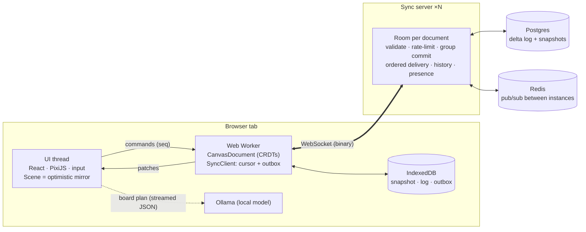
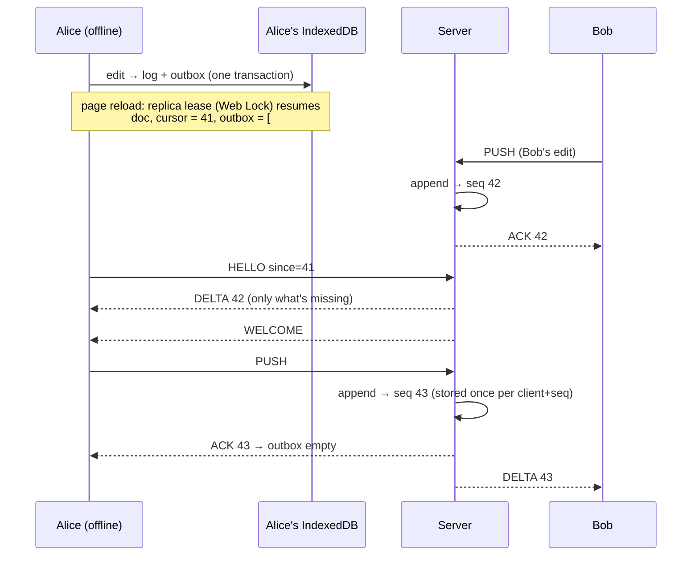

# Tandem: a local-first collaborative whiteboard, CRDT engine written from scratch

A real-time whiteboard (sticky notes, shapes, connectors, frames, pen, comments) where every
edit works offline, survives a page refresh, and merges with everyone else's — without a
central "source of truth" deciding conflicts. The sync engine is hand-written: no Yjs, no
Automerge. It has a scroll-story homepage, a boards dashboard with templates, live
collaboration (cursors, cursor chat, reactions, follow mode), time travel, export, share
links, and an AI that runs on your own machine.

> **Interview summary:** "I wrote the CRDTs (HLC, LWW map, Kleppmann's move tree, Fugue text),
> proved convergence with property-based tests against reference implementations and with
> deliberately injected bugs, then built offline-first sync, selective undo, time travel, and a
> horizontally scaled server on top — and measured all of it."

## What's in it

| Layer | What | Where |
|---|---|---|
| **CRDT engine** | Hybrid Logical Clock, PN-counter, LWW register & map, move-tree (Kleppmann 2021), Fugue text (Weidner 2023), fractional indexing | [`packages/crdt`](packages/crdt) |
| **Document** | Shapes = tree node + LWW property map; selective undo/redo; restore-to-version | [`packages/doc`](packages/doc) |
| **Sync** | Binary wire format, cursor + outbox protocol, presence, IndexedDB journal, Web-Lock replica leases | [`packages/sync`](packages/sync) |
| **Server** | Ordered per-document delivery, group-commit Postgres log, snapshots, history, Redis fan-out across instances, signed tokens, rate limits | [`apps/server`](apps/server) |
| **AI** | Local model (Ollama) → validated board plan, streaming JSON parser, deterministic layout | [`packages/ai`](packages/ai) |
| **App** | React 19 + PixiJS 8 canvas, engine in a Web Worker; homepage, dashboard and board routes | [`apps/web`](apps/web) |

### Features

| Area | What you can do |
|---|---|
| **Homepage** (`/`) | A cinematic 3D scroll story (Three.js + GSAP ScrollTrigger + Lenis, bloom): the camera flies through a living board while eight named cursors work on it — notes assemble, get dragged into a mind map, the board splits into two offline devices and merges with a shockwave, rewinds inside a clock ring, and AI cards stream out of a glowing orb |
| **Dashboard** (`/boards`) | Your boards with thumbnails, search, star, join by link; start blank or from a template (kanban, retro, flowchart, mind map, brainstorm) |
| **Editing** | Notes, rectangles, ellipses, diamonds, text, frames, pen, comments; **connectors that stay attached**; resize and rotate handles; snapping with alignment guides; align and distribute; copy, paste (text becomes a note), duplicate, Alt-drag to copy; frames carry their contents; wrap a selection in a frame; nudge with arrow keys; minimap and zoom controls; **⌘K command palette** for everything |
| **Together** | Live cursors and selections, **cursor chat** (`/`), **emoji reactions** (1–6), **follow a teammate's view** (click their avatar), live text as people type, synced board name, an **AI team session** (8 bot teammates brainstorm, sort and vote on a topic in their own frame beside your board) |
| **Rituals & presenting** | **Present mode** (frames become slides, cinematic camera, everyone follows), **laser pointer** with a glowing trail, **spotlight**, **dot voting** (5 each, concurrency-safe), a **shared timer** with chime and confetti |
| **Flow** | **Quick-connect** + handles on hover, **radial right-click menu**, springy pop animations, first-visit **guided tour** |
| **Offline & history** | Works with no connection (edits queue on the device and merge later), selective undo (only your own edits), **time travel** slider with restore |
| **Share & export** | Edit and view-only links (server-signed when auth is on), **PNG / SVG / PDF** export of the board or the selection |
| **Layout** | Pro editor: header with Present/Share, left sidebar (**Pages**, **Layers** with search, **Templates**), right panel with **Design** (exact color, position, size, rotation, text, arrange) and **AI** |
| **AI (local)** | **Detailed plans** (phases as frames; cards with detail, owner, due date, priority), **flowcharts and mind maps** with real connectors, **charts** (bar, line, area, pie, donut, funnel), **interactive 3D scenes**, **slide decks** that play in Present mode with animated reveals, summaries with what's missing; choose the local model in the panel |

## How it fits together



The sync protocol in one picture: an edit made offline survives a reload and is sent exactly
once, while the other client's edits arrive as only what's missing.



- **Every edit is local first.** It applies to the worker's CRDT immediately, is journaled to
  IndexedDB in the same step, and is pushed to the server when there's a connection.
- **The server orders, it doesn't decide.** It numbers each document's deltas (1, 2, 3…), stores
  them, and relays them. Conflicts are resolved by the CRDTs, identically on every replica.
- **Reconnecting sends only what's missing:** the client says "I've seen up to N"; it gets N+1….
  Its outbox (unacknowledged edits) is resent; the server stores each edit exactly once.

## Run it

Requirements: Node 22+, pnpm 10, Docker (for Postgres/Redis; optional for plain dev).

```bash
pnpm install
pnpm db:up          # Postgres :5433 + Redis :6380 (docker compose)
pnpm dev            # web on :5173, sync server on :8787
```

Open `http://localhost:5173` for the homepage, or `/boards` to start a board. Open the same
board in two windows to collaborate. Try: go offline (click "Synced" next to the board name),
edit in both, refresh the offline one, go back online. Press `/` to chat at your cursor,
`1`–`6` to react, click the other person's avatar to follow them, `⌘K` for every command.
Open **History** (clock icon in the dock) and drag the slider.

Without `DATABASE_URL` the server keeps documents in memory. Configuration: see
[`.env.example`](.env.example) and [`apps/server/src/main.ts`](apps/server/src/main.ts).

```bash
pnpm check          # lint + typecheck + all tests (Postgres/Redis tests run if the env vars are set)
pnpm build
```

## Correctness

Every CRDT is tested three ways: named scenarios, algebraic laws (merge is commutative,
associative, idempotent), and **fuzzed convergence against an independent reference
implementation** — 10,000 random histories each, with skewed clocks and late, duplicated and
reordered delivery. Tests are themselves tested: each milestone injects plausible bugs
(e.g. "apply moves in arrival order", "ACK outside the ordered stream") and confirms they fail.

Highlights:
- **Move tree:** concurrent "A into B" and "B into A" never create a cycle; matches a
  sort-and-replay reference for every delivery order.
- **Text:** three people typing at the same spot (forward or backward) never interleave words.
- **Undo:** undoing all of Alice's edits never changes a property Bob currently owns
  (1,000 random interleavings).
- **Sync:** offline edits sync after reconnect with *only the missing deltas* — counted on the wire.
- **Multi-instance:** 3 servers with a bus that reorders and *loses* messages; every client still
  ends with exactly the store's full log applied.

## Performance

### Rendering (M4)

5,000 shapes on screen, 500 of them moving every frame through the real path (UI → worker →
patch → renderer) while panning and zooming: **main-thread work 2.9 ms median, 3.9 ms p95** per
frame — under a quarter of a 60 fps frame. The CRDT update for those 500 shapes takes 0.6 ms in
the worker, off the UI thread. (`Benchmark` button in the app.)

### Sync server (M8)

Load generator: real server **processes**, real Postgres (+ Redis for 2 instances), and
100–400 real `SyncClient`s — the same code the browser runs — each editing 10×/s. Latency is
end to end: an edit leaving one client → arriving at the other 4 clients on its document.
Every run ends with a correctness check: **0 diverged documents in every run below.**

| Run | Servers | Routing | Edits/s | Deliveries/s | p50 | p95 | p99 |
|---|---|---|---|---|---|---|---|
| A | 1 | — | 920 | 3,679 | **43 ms** | 67 ms | 79 ms |
| C | 1 | — | 1,937 | 7,748 | **90 ms** | 160 ms | 220 ms |
| E | 2 | by document | 1,958 | 7,831 | **76 ms** | 174 ms | 258 ms |
| B | 2 | split (worst case) | 980 | 3,921 | 77 ms | 193 ms | 232 ms |
| D | 2 | split (worst case) | 1,945 | 7,778 | 284 ms | 532 ms | 649 ms |
| G | 1 | — | 3,832 | 15,330 | 270 ms | 535 ms | 756 ms |
| F | 2 | by document | 3,678 | 14,713 | 300 ms | 576 ms | 790 ms |

What the numbers say:
- **Group commit was the big win.** Before it, the same 1,000 edits/s had a **p50 of 1,436 ms**
  and 2,000/s fell behind by 13 s: every delta was its own Postgres transaction (~4 round
  trips), serialized per document. Now edits that queue up while a transaction runs go in the
  next one together. (With an in-memory store the same load runs at p50 3 ms — that's how the
  database was identified as the bottleneck, rather than guessed.)
- **Route by document.** When one document's clients are split across instances, every edit
  crosses Redis and both instances contend on that document's lock (D: 3× the latency of C).
  When a load balancer hashes on doc id (E), the bus is idle and 2 instances match or beat 1.
  Redis then exists for correctness when clients do end up split — not for the hot path.
- **The ceiling here is the laptop, not the design.** Everything — 2 servers, Postgres, Redis
  and up to 400 clients — shares one 4-core i5-11300H (Windows, Docker Desktop). At 4,000
  edits/s, two instances don't beat one because they share the same CPU and database. The load
  generator itself starts lagging there too (event-loop p99 55 ms), so treat F/G as a lower
  bound on what the servers can do.

Reproduce: `pnpm db:up`, then
`pnpm --filter @canvas/server load -- --instances 2 --docs 40 --clients 5 --rate 10 --seconds 20 --routing affinity`.

## Local AI

`AI` in the dock opens an assistant that runs on [Ollama](https://ollama.com) **on your
machine** — prompts and boards never leave it. Default model `gemma3:4b` (3.3 GB;
`ollama pull gemma3:4b`).

- **Board:** "Sprint retro: went well, didn't, actions" → a titled board of colored columns.
- **Flowchart / Mind map:** "How a pull request gets merged" → steps, decisions and
  connectors; nodes appear as they stream, then glide into a layered (or radial) layout
  with the arrows following.
- **Summarize:** reads the board (or the selection) and writes a summary, key points and
  **what's missing**, as a frame of notes beside it.
- **Organize notes:** select sticky notes → they're sorted into columns. Your notes *move*;
  nothing is duplicated.

How it's built: the model returns content through a JSON schema Ollama enforces (never
coordinates; layout is deterministic code). The JSON is parsed *while it streams*, so cards
land one by one as the model writes. All output is validated and capped. The result is
ordinary local edits in one undo group: it syncs to everyone, and one Ctrl+Z removes it.

Measured with `pnpm --filter @canvas/ai eval` (gemma3:4b, CPU only, ~12 tokens/s):

| Case | First card | Total | Cards | Notes placed |
|---|---|---|---|---|
| Create: app launch | 5.4 s | 37.7 s | 30 | — |
| Create: retro | 3.6 s | 14.2 s | 9 | — |
| Organize: 8 notes | 3.0 s | 12.5 s | 8 | **8 / 8** |

Diagrams and summaries, measured with `pnpm --filter @canvas/ai eval:diagram`:

| Case | First node | Total | Nodes / edges | Unconnected |
|---|---|---|---|---|
| Flowchart: pull request | 17.1 s | 58.5 s | 13 / 13 | 0 |
| Flowchart: refund process | 3.0 s | 40.5 s | 11 / 11 | 0 |
| Mind map: team offsite | 2.2 s | 13.1 s | 17 / 16 | 0 |
| Mind map: newsletter | 2.0 s | 12.9 s | 17 / 16 | 0 |
| Summarize a kanban board | — | 14.4 s | summary + 5 points + 5 missing | — |

The eval also caught a real failure the unit tests couldn't: the first "organize" design let
the model copy note text, and gemma3:4b did, placing 0/8 notes and making 8 duplicates. The
fix makes the model answer with note *numbers* only (see D046). The diagram eval found two
more (edges wired by label, mind-map ids lost); see D058.

## Demo

A 4-minute walkthrough script (real-time, offline refresh, conflicts and selective undo, time
travel, local AI): [`docs/DEMO.md`](docs/DEMO.md). Dark mode follows the system, or use the
theme toggle in the top bar. View-only links (`?mode=view`, or a viewer `?token=`) open the
board read-only.

## Design decisions

Every non-obvious choice — what was picked, what was rejected, and why, including the bugs that
changed the design — is in [`DECISIONS.md`](DECISIONS.md). Known gaps and next steps are in
[`LATER.md`](LATER.md).
